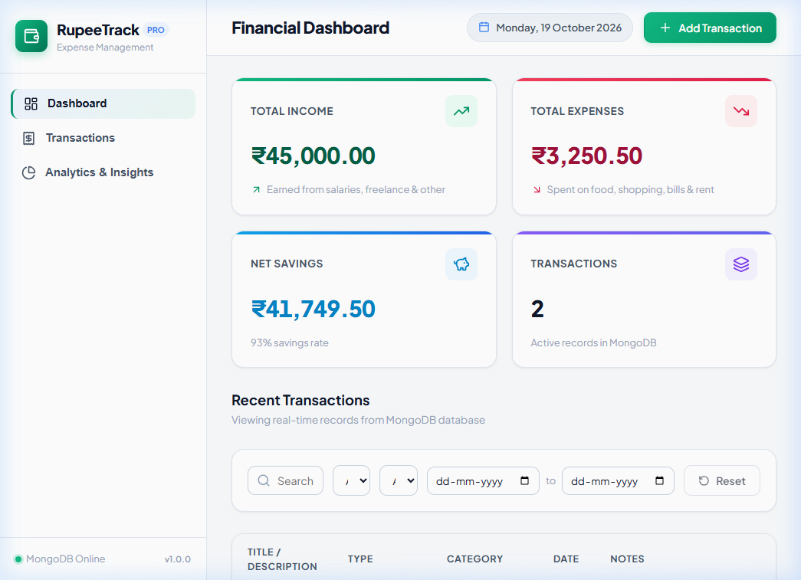
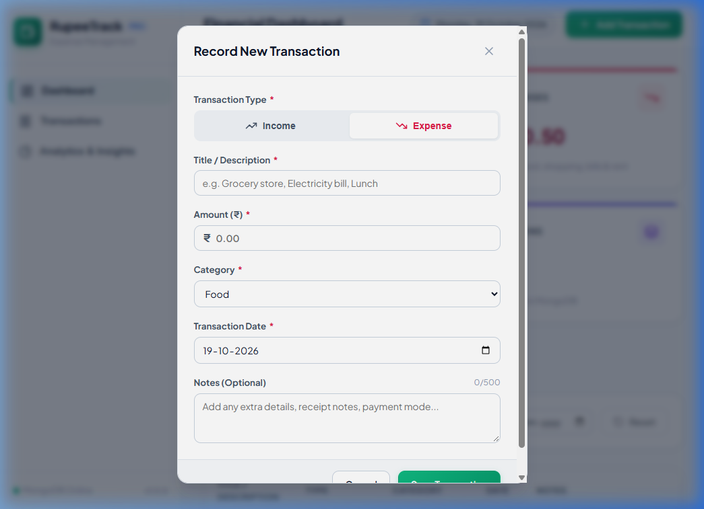
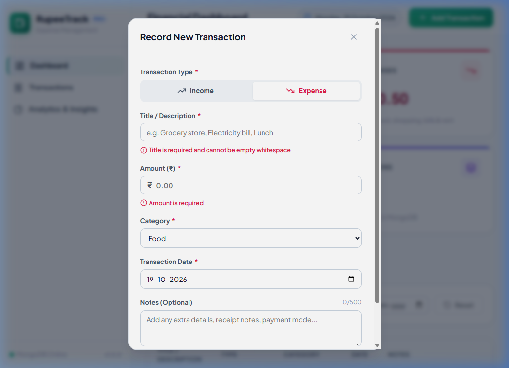
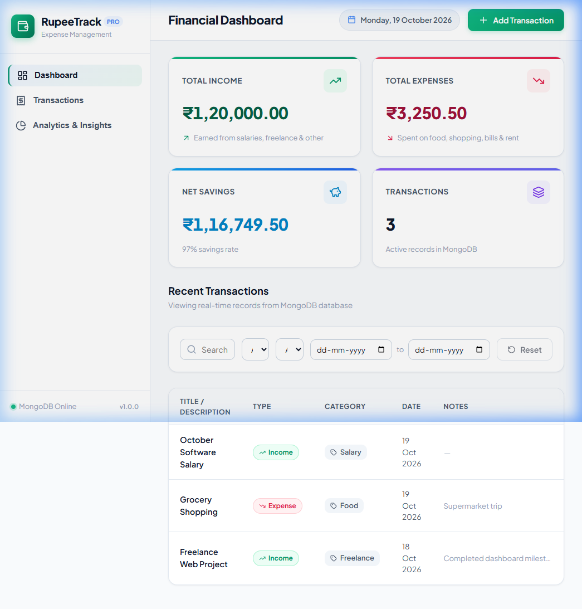

# SpendSphere — Full-Stack Expense Tracker & Financial Management Platform
# SpendSphere — Full-Stack Expense Tracker & Financial Management Platform

[](https://nodejs.org/)
[](https://react.dev/)
[](https://expressjs.com/)
[](https://www.mongodb.com/)
[](LICENSE)

A production-grade, full-stack personal finance application built with **React, Vite, Node.js, Express, and MongoDB**. SpendSphere allows users to log income and expenses, monitor real-time balance calculations, track category-wise expenditure, visualize financial trends with dynamic charts, set monthly budgets, and manage transactions with dual-layer validation and persistent storage.

---

## 📸 Application Screenshots

| Dashboard Overview | Add Transaction Modal |
|:---:|:---:|
|  |  |
| *Real-time financial cards, Indian Rupee formatting (₹), category donut chart & monthly budget tracker* | *Dynamic category selector, amount validation, date picker with future-date blocking* |

| Dual-Layer Validation Feedback | Updated Transaction Records |
|:---:|:---:|
|  |  |
| *Instant client & server validation against non-positive amounts, whitespace titles & future dates* | *Chronological transaction history with edit/delete controls and reactive summary updates* |

---

## 🌟 Key Features

### 1. Dynamic Financial Summary Dashboard
- **Total Income:** Accurate aggregation of all valid income transactions from MongoDB.
- **Total Expenses:** Sum of all recorded expense entries.
- **Net Savings:** Calculated dynamically as `Total Income − Total Expenses`.
- **Indian Rupee (₹) Formatting:** Formats numbers according to the Indian numbering system (e.g., `₹1,50,000.00`).
- Displays `₹0` cleanly when no transactions exist—zero hardcoding.

### 2. Add & Edit Transaction Workflow
- **Type Toggle:** Seamlessly switch between **Income** and **Expense**.
- **Context-Aware Categories:**
  - *Income Categories:* `Salary`, `Freelance`, `Business`, `Scholarship`, `Gift`, `Investment`, `Rental Income`, `Other`
  - *Expense Categories:* `Food & Dining`, `Travel & Transit`, `Shopping`, `Education`, `Bills & Utilities`, `Healthcare`, `Entertainment`, `Rent & Housing`, `Personal Care`, `Other`
- **Strict Data Validation:** Rejects negative amounts, zero, `NaN`, `Infinity`, empty strings, and future calendar dates.
- **Anti-Duplicate Submission:** Buttons disable with animated spinners while asynchronous requests are pending.
- **Form State Safety:** Form clears only upon verified HTTP `201/200` server response.

### 3. Interactive Transaction History
- **Dual Presentation:** Clean tabular layout on desktop viewports and adaptive responsive cards on mobile screens.
- **Visual Status Badges:** Emerald green styling for income records and coral red for expenses.
- **Search & Filtering:**
  - Case-insensitive search across transaction title and optional notes.
  - Type filter (`All`, `Income`, `Expense`).
  - Category filter dropdown.
  - Date range filters (`Start Date` to `End Date`).
  - Single-click **Reset Filters** button with active-filter count badge.
- **Delete Confirmation Modal:** Protects against accidental data deletion.

### 4. Visual Financial Analytics
- **Cashflow Bar Charts:** Compares monthly income against monthly expenses.
- **Category Donut Breakdown:** Visualizes proportional expenditure across expense categories.
- **Monthly Budget Card:** Visual progress bar tracking spending relative to monthly limits with threshold warnings.

### 5. Dual-Layer Validation & Reliability
- **Client-Side Validation:** Inline field validation prevents invalid requests from reaching the network.
- **Server-Side Validation:** Validates required types, positive numbers, category matching, date boundaries, and MongoDB ObjectIds.
- **Toast Notifications:** Feedback on success, validation failures, and network interruptions.

---

## 🛠️ Technology Stack

| Layer | Technologies Used |
|---|---|
| **Frontend** | React 19, Vite, Tailwind CSS, Lucide React Icons, Recharts, React Hot Toast, Axios |
| **Backend** | Node.js (v18+), Express.js (v4.x), Morgan Logger, CORS, Dotenv |
| **Database** | MongoDB (Local Community Server / MongoDB Atlas), Mongoose ORM |
| **Testing** | Node Test Runner (`node:test`, `node:assert`), Playwright / Browser Automation |

---

## 📁 Repository Structure

```
expense-tracker/
├── client/                     # Frontend Single Page Application (React + Vite)
│   ├── public/                 # Static assets and icons
│   ├── src/
│   │   ├── charts/             # Cashflow and Category Recharts components
│   │   ├── components/         # Modals, summary cards, filter bars, tables
│   │   ├── layouts/            # Navigation bar and responsive sidebar
│   │   ├── services/           # Axios HTTP client and REST endpoint wrappers
│   │   ├── utils/              # Currency (₹ INR), date helpers, formatters
│   │   ├── App.jsx             # Root React component managing app state
│   │   ├── main.jsx            # Application entrypoint
│   │   └── index.css           # Styling system and utilities
│   ├── package.json
│   ├── vite.config.js
│   ├── .env.example
│   └── .env
├── server/                     # Backend REST API Server (Node + Express)
│   ├── src/
│   │   ├── config/             # MongoDB connection logic
│   │   ├── controllers/        # Route handlers for transactions, summary, budget
│   │   ├── middleware/         # Centralized error handler, 404 handler, logging
│   │   ├── models/             # Mongoose schemas (Transaction, Budget)
│   │   ├── routes/             # Express API route declarations
│   │   ├── utils/              # Date calculations and database seed utilities
│   │   ├── validators/         # Server-side validation rules
│   │   ├── app.js              # Express application setup
│   │   └── server.js           # Server bootstrap and port listener
│   ├── tests/                  # Automated unit test suite
│   ├── package.json
│   ├── .env.example
│   └── .env
├── screenshots/                # Application verification screenshots
├── package.json                # Root package with unified workspace commands
├── .gitignore
└── README.md
```

---

## 🚀 Getting Started

### Prerequisites
- **Node.js:** v18.0.0 or higher ([Download Node.js](https://nodejs.org/))
- **npm:** v9.0.0 or higher
- **MongoDB:** Local MongoDB Community Server running on `mongodb://127.0.0.1:27017` OR a free [MongoDB Atlas Cluster](https://www.mongodb.com/cloud/atlas).

---

### Step 1: Clone and Install Dependencies

```bash
# Clone the repository
git clone https://github.com/Shivk/expense-tracker.git
cd expense-tracker

# Install dependencies for both backend and frontend via root command
npm run install:all

# OR install individually:
cd server && npm install
cd ../client && npm install
```

---

### Step 2: Configure Environment Variables

#### Backend Configuration (`server/.env`)
Create `server/.env` based on `server/.env.example`:

```env
PORT=5050
MONGODB_URI=mongodb://127.0.0.1:27017/spendsphere
CLIENT_URL=http://localhost:5173
NODE_ENV=development
```

#### Frontend Configuration (`client/.env`)
Create `client/.env` based on `client/.env.example`:

```env
VITE_API_URL=http://localhost:5050/api
```

---

### Step 3: Seed Sample Data (Optional)

To populate the database with realistic sample incomes, expenses, and budget data:

```bash
# Run from root directory
npm run seed

# Or run from inside server/
cd server
npm run seed
```

---

### Step 4: Run the Application

You can launch both services using two terminal windows:

#### Terminal 1 — Start the Backend API
```bash
npm run dev:server
# Server runs at http://localhost:5050
```

#### Terminal 2 — Start the Frontend Client
```bash
npm run dev:client
# Client runs at http://localhost:5173 (or assigned Vite port)
```

Open your browser and navigate to **`http://localhost:5173`** to access SpendSphere!

---

## 🧪 Running Automated Tests

SpendSphere includes unit tests covering:
- Positive/negative amount rejection
- Mismatched categories and transaction types
- Whitespace and character length boundaries
- Date range calculations
- Budget thresholds

To execute the test suite:

```bash
npm run test:server
# Or: cd server && npm test
```

---

## 📡 REST API Documentation

Base URL: `http://localhost:5050/api`

| Method | Endpoint | Description | Status Codes |
|---|---|---|---|
| `GET` | `/health` | Server and database health check | `200` |
| `GET` | `/summary` | Get financial totals (Income, Expense, Net Savings, Trends) | `200` |
| `GET` | `/cashflow` | Monthly cashflow dataset for visual charts | `200` |
| `GET` | `/categories` | Category-wise spending breakdown | `200` |
| `GET` | `/budget` | Retrieve current month budget target and usage | `200` |
| `PUT` | `/budget` | Set or update monthly budget limit | `200`, `400` |
| `GET` | `/transactions` | List transactions with search, filters, and pagination | `200` |
| `POST` | `/transactions` | Record a new income or expense transaction | `201`, `400` |
| `GET` | `/transactions/:id` | Retrieve single transaction by MongoDB ID | `200`, `400`, `404` |
| `PUT` | `/transactions/:id` | Update an existing transaction | `200`, `400`, `404` |
| `DELETE` | `/transactions/:id` | Delete transaction and recalculate balance | `200`, `400`, `404` |

---

### API Request & Response Examples

#### 1. Create Transaction (`POST /api/transactions`)

**Request Body:**
```json
{
  "title": "Software Freelance Project",
  "type": "income",
  "amount": 45000,
  "category": "Freelance",
  "date": "2026-10-18",
  "paymentMethod": "UPI / Bank Transfer",
  "notes": "First milestone payment"
}
```

**Success Response (`201 Created`):**
```json
{
  "success": true,
  "message": "Transaction created successfully",
  "data": {
    "_id": "6ad5cbddc05318ed1def3a25",
    "title": "Software Freelance Project",
    "type": "income",
    "amount": 45000,
    "category": "Freelance",
    "date": "2026-10-18T00:00:00.000Z",
    "paymentMethod": "UPI / Bank Transfer",
    "notes": "First milestone payment",
    "createdAt": "2026-10-19T07:50:53.337Z",
    "updatedAt": "2026-10-19T07:50:53.337Z"
  }
}
```

#### 2. Get Financial Summary (`GET /api/summary?period=this_month`)

**Success Response (`200 OK`):**
```json
{
  "success": true,
  "data": {
    "totalIncome": 125000,
    "totalExpenses": 38450.50,
    "netSavings": 86549.50,
    "savingsRate": 69.24,
    "transactionCount": 14,
    "period": "this_month"
  }
}
```

#### 3. Validation Error Response (`400 Bad Request`)

**Request with invalid/negative amount:**
```json
{
  "title": "Grocery store",
  "type": "expense",
  "amount": -500,
  "category": "Food & Dining",
  "date": "2026-10-18"
}
```

**Response:**
```json
{
  "success": false,
  "message": "Validation failed",
  "errors": [
    "Amount must be a finite number strictly greater than zero"
  ]
}
```

---

## 🗄️ Database Schemas

### Transaction Model (`Transaction.js`)
```javascript
{
  title: { type: String, required: true, trim: true, minlength: 2, maxlength: 100 },
  type: { type: String, required: true, enum: ['income', 'expense'] },
  amount: { type: Number, required: true, min: 0.01 },
  category: { type: String, required: true, trim: true },
  date: { type: Date, required: true },
  paymentMethod: { type: String, default: 'UPI / Online' },
  notes: { type: String, maxlength: 500, default: '' },
  timestamps: true // createdAt, updatedAt
}
```

### Budget Model (`Budget.js`)
```javascript
{
  month: { type: Number, required: true, min: 1, max: 12 },
  year: { type: Number, required: true },
  monthlyLimit: { type: Number, required: true, min: 1 },
  timestamps: true
}
```

---

## ☁️ Deployment Guide

### 1. Database — MongoDB Atlas
1. Sign up at [MongoDB Cloud](https://cloud.mongodb.com/).
2. Create a free **M0 Sandbox** cluster.
3. Under **Database Access**, create a user with read/write credentials.
4. Under **Network Access**, add `0.0.0.0/0` (Allow Access from Anywhere) to permit cloud hosts to connect.
5. In your cluster view, click **Connect** → **Drivers** and copy your URI:
   ```
   mongodb+srv://<username>:<password>@cluster0.xxxx.mongodb.net/spendsphere?retryWrites=true&w=majority
   ```

### 2. Backend — Render.com
1. Create a new **Web Service** on Render connected to this repository.
2. Set **Root Directory** to `server`.
3. Set **Build Command** to `npm install`.
4. Set **Start Command** to `node src/server.js`.
5. Add Environment Variables:
   - `PORT`: `5050`
   - `NODE_ENV`: `production`
   - `MONGODB_URI`: `<Your MongoDB Atlas Connection String>`
   - `CLIENT_URL`: `<Your Vercel Frontend URL>`

### 3. Frontend — Vercel
1. Import this repository into [Vercel](https://vercel.com/).
2. Set **Root Directory** to `client`.
3. Framework Preset: **Vite**.
4. Set Build Command: `npm run build`.
5. Add Environment Variable:
   - `VITE_API_URL`: `<Your Render Backend API URL>/api` (e.g., `https://spendsphere-api.onrender.com/api`)
6. Click **Deploy**.

---

## 🔧 Troubleshooting Common Issues

### Issue 1: MongoDB Connection Refused (`ECONNREFUSED 127.0.0.1:27017`)
- **Cause:** Local MongoDB service is not started.
- **Solution (Windows PowerShell):**
  ```powershell
  Get-Service -Name *mongo* | Start-Service
  ```
  Or check that MongoDB daemon is running via Task Manager / Services.

### Issue 2: Port Conflict (`EADDRINUSE: address already in use :::5050`)
- **Cause:** Another process is occupying port 5050.
- **Solution:** Edit `server/.env` and choose an available port (e.g. `PORT=5001` or `PORT=5055`), then update `client/.env` (`VITE_API_URL=http://localhost:5001/api`).

### Issue 3: CORS Policy Errors
- **Cause:** Frontend port differs from `CLIENT_URL` configured in `server/.env`.
- **Solution:** Verify `CLIENT_URL` in `server/.env` matches the port where Vite is running (e.g. `http://localhost:5173` or `http://localhost:5174`).

---

## 📜 License
This project is open-source and distributed under the **MIT License**.
